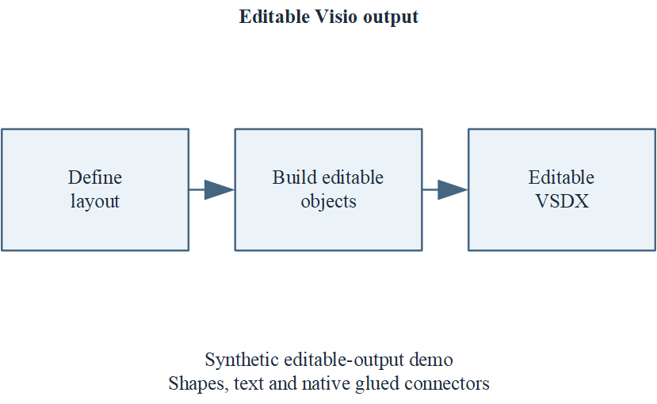

# Synthetic editable-output demo

This example is an original, tiny diagram for exercising the skill's **output** and verification workflow. It does not implement automatic raster recognition and contains no third-party figure or paper image.

## Reproduce on Windows with desktop Microsoft Visio

From the repository root, use Windows PowerShell or PowerShell 7:

```powershell
# Pick a new directory; existing outputs are never overwritten.
.\scripts\create_demo.ps1 -OutputDirectory .\examples\reproduced

# Static package check after successful generation:
python .\scripts\validate_vsdx.py .\examples\reproduced\demo.vsdx --profile source --report .\examples\reproduced\static-validation.json
```

An interactive Windows login with a working Visio COM registration is required. The script creates its own `Visio.InvisibleApp` instance. It never attaches to an existing Visio document. Existing documents are opened only as the read-only render input or as a disposable test copy, with macros and data refresh disabled.

Expected outputs after a successful run:

- `demo.vsdx`: one 80 x 60 mm page, editable title, three boxes and caption; all text is 6 pt Times New Roman. Two native connectors use `GlueTo`.
- `render/page-001_preview.png`: exported from the actual VSDX by `scripts/render_visio.ps1`, at 300 dpi.
- `render/render.json`: source SHA256 and actual Visio export metadata; paths are relative to the manifest directory.
- `interaction-check.json`: separate generation, render and interaction states. A temporary `work/interaction-.../disposable.vsdx` is resized and moved, saved and reopened, then removed. The report checks visible `BoundingBox(4)` width growth and that a native glued connector's end point follows its moved target. The original VSDX SHA256 must remain unchanged.

Open the exported preview and inspect text, layout, clipping and connections separately. Successful export and interaction tests alone do not establish visual fidelity for arbitrary source figures. Run the static validator separately; its JSON is a distinct report and does not certify application opening.

## Result recorded in this source checkout

The included files were generated on 2026-10-21 using Microsoft Visio 16.0 on Windows:

- `static-check.json`: implemented static checks passed, with no warnings; seven shapes, five text shapes, four glue records (two connectors), and no image or embedded-object parts.
- `render/render.json`: the final VSDX opened and exported successfully. Its recorded SHA256 matches `demo.vsdx`. The PNG was visually reviewed for readable text, attached arrows, and clipping.
- `interaction-check.json`: representative visible resize and connector-following tests passed on a disposable copy after saving and reopening. The final source remained unchanged.

The resize test increases one block's width by 20 percent and checks its visible bounds. The connector test moves a target block by 18 mm, verifies that its new and old bounds no longer overlap, and checks that the endpoint has moved onto the new boundary and retained its native glue relationship. Walking glue can choose a different boundary point, so equal endpoint and block displacement is not a general invariant.

These are checks of the included synthetic diagram, not a guarantee of fidelity or editability for an arbitrary reconstruction. The static report deliberately retains its own unverified list; the separate render and interaction reports provide the additional evidence.

If COM reports HRESULT 0x80070520, the process may not have access to an interactive desktop session. Re-run through the environment's normal approval process in that session; do not attach to or terminate an existing user Visio instance.


